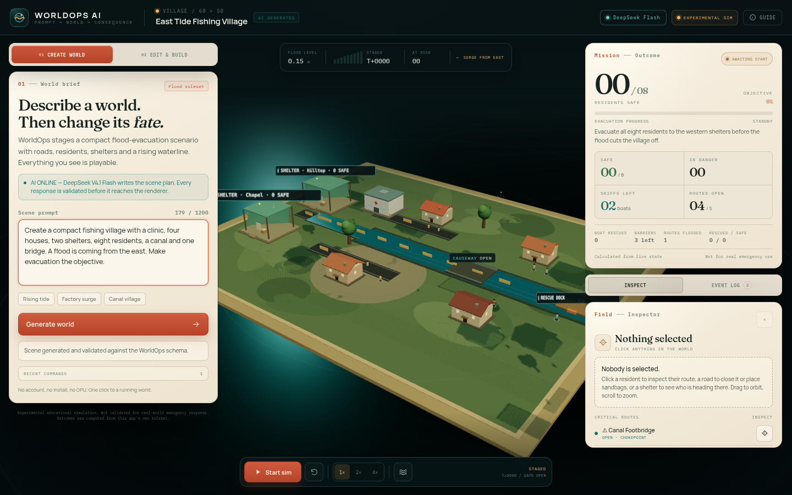
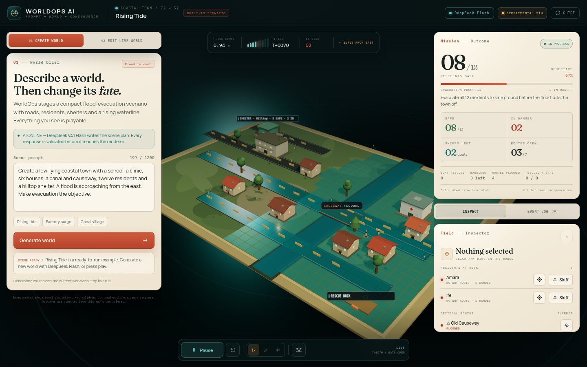
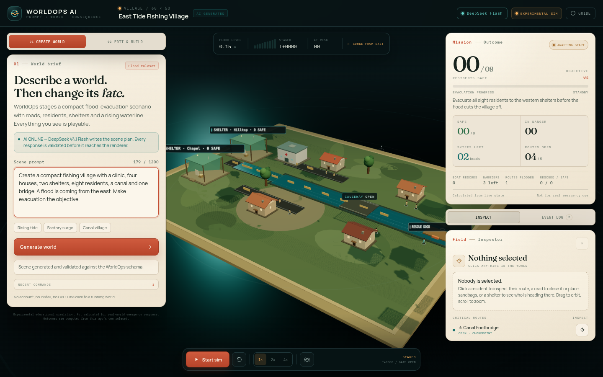
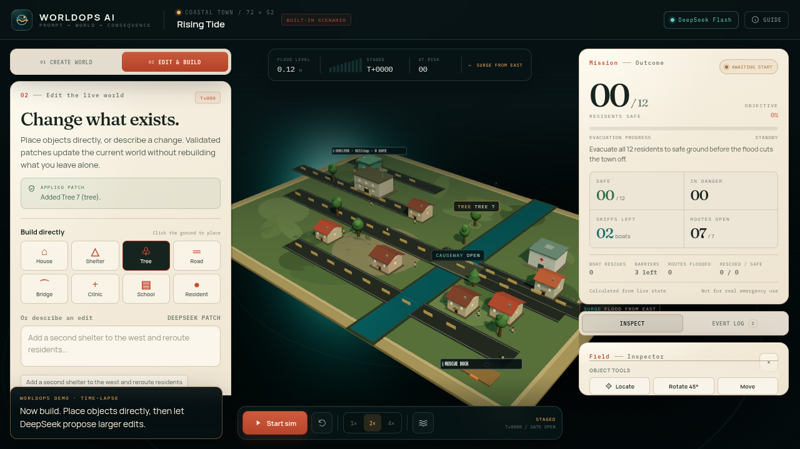

# WorldOps AI

**Prompt a world. Change its fate.**

WorldOps AI is a browser-based prompt-to-world tool built for the
[Victoria VR AI Builder Hackathon 2026](https://www.victoriavr.com/news/ai-builder-hackathon-2026-the-building-period-2042daf3).
Describe a coastal town and an approaching flood; WorldOps turns it into a playable
3D scene with a deterministic evacuation simulation underneath. Then you intervene —
dispatch rescue skiffs, place sandbags, close routes, hold the flood gate — and edit the
existing world in natural language.



> Experimental educational simulation; not validated for real-world emergency response.
> The flood is a stylized ruleset, not fluid dynamics.

**Chosen focus category:** Prompt-to-World Creation (AI-assisted world editing and
autonomous agents).

**Live demo:** https://worldops-ai.vercel.app
**Demo video:** https://worldops-ai.vercel.app/worldops-demo.mp4
**Public source:** https://github.com/bolajiev/worldops-ai

The hosted demo is now running **DeepSeek V4.1 Flash** through OpenCode Go. The API key is
server-side only; nothing is exposed to the browser.

---

## Why this is not a static AI scene

Most prompt-to-3D demos stop at a picture. WorldOps separates three jobs:

1. **AI proposes.** A server-side model returns a structured `ScenePlan` or a
   constrained patch. It never writes executable code.
2. **Application code validates.** Zod checks structure; normalization enforces bounds,
   unique IDs, caps and defaults. Patches are applied atomically.
3. **Deterministic code decides.** A fixed-tick simulation runs navigation, flooding,
   resident decisions, rescue trips and resource use. Every outcome number is calculated
   from real state — never written by the model.

The result is a world that can be inspected, played, changed and measured.

### What actually changes the outcome

- **Dispatch a rescue skiff** — limited resource; moves to stranded residents, recovers up
  to two, returns to the rescue dock. One well-timed skiff turns the flagship run from
  **10/12 safe** into **12/12**.
- **Deploy a sandbag barrier** on a road or bridge — protects that route from flooding for
  a limited number of ticks. On the causeway it prevents the early east-bank cutoff.
- **Close / reopen a route** — residents re-path on the next tick; blocked-route metrics
  change immediately.
- **Hold the flood gate** — freezes both the gradual rise and scheduled surges.
- **Natural-language edits** — add a shelter, bridge, house, residents; reroute people;
  close a road. Unchanged entities keep their IDs and positions.

---

## The 90-second demo

1. Open the app. The built-in **Rising Tide** scenario is staged (no start-up wait).
2. Press **Start sim**. Residents choose the hilltop shelter and start walking west.
3. The causeway overtops around tick 40. Two slow residents are cut off on the east bank;
   the inspector shows them as **no dry route**.
4. Choose **Skiff** on one of them. A rescue craft crosses the flooded east side, recovers
   both, and returns to the rescue dock. The outcome becomes **12/12 safe**.
5. Reset. Open **Edit & build**. Either place a house directly (Build directly → House →
   click the ground), or enter:
   *“Add a second shelter to the west and reroute residents.”*
   DeepSeek proposes the patch; the app validates and applies it, adds the shelter, and
   redirects all 12 residents while every original ID stays stable.
6. Or try the alternative: select **Old Causeway** → **Deploy barrier**, then hold the
   flood gate. The route stays open and the crowd crosses.

The unassisted run really does fail (10 safe, 2 in danger at the peak). The comparison is
computed by the simulation, not by an LLM.



### Demo video

The demo video at https://worldops-ai.vercel.app/worldops-demo.mp4 is recorded from the real
UI. Where the simulation is advanced between shots it is labelled **time-lapse**; the hosted
app runs in real time. No generated footage or mock model calls are presented as real.





---

## AI modes (important)

WorldOps has two clearly separated modes:

### 1. AI mode — set `LLM_API_KEY` server-side

- `POST /api/generate-scene` sends a bounded prompt to an OpenAI-compatible chat
  completions endpoint and asks for a JSON `ScenePlan`.
- `POST /api/edit-scene` sends the current plan plus the request and asks for constrained
  patch operations only.
- Both routes validate every response server-side, retry once with the validation error,
  enforce a timeout, rate-limit callers and fall back to the built-in scene.
- The API key is read only on the server. There is no `NEXT_PUBLIC_` key and no provider
  key in the client bundle.
- Provider/base URL/model are configurable (`LLM_BASE_URL`, `LLM_MODEL`).

### 2. Fallback local mode — no key required

- The built-in **Rising Tide** scenario loads and the full simulation is playable.
- Natural-language edits are handled by a deterministic local parser that recognises a
  small, documented set of scene changes (shelter, bridge, house, clinic, school, route
  closure, reroute, extra residents).
- The UI labels this mode **LOCAL DEMO** / **LOCAL PARSER**; nothing pretends an LLM was
  called. Unsupported requests fail with a helpful 422 and suggestions.

> **Hosted demo:** AI is live at https://worldops-ai.vercel.app using **DeepSeek V4.1
> Flash** through OpenCode Go. The key is server-side only. Local mode remains the explicit
> fallback when the provider/key is unavailable; it is clearly labelled and never presented
> as an AI result.

---

## How it works

```text
natural-language prompt
        │
        ▼
┌──────────────────────────┐       no key / failure
│ /api/generate-scene      │ ───────────────────────► built-in Rising Tide
│ provider adapter (JSON)  │                          (clearly labelled)
└─────────────┬────────────┘
              │ raw ScenePlan
              ▼
┌──────────────────────────┐
│ Zod schema + normalizer  │  unique IDs, bounds, caps, defaults, references
└─────────────┬────────────┘
              │ ScenePlan
              ▼
┌──────────────────────────┐     ┌──────────────────────────┐
│ Zustand canonical state  │ ──► │ React Three Fiber scene  │
│ plan + simulation runtime│     │ procedural low-poly town │
└─────────────┬────────────┘     └──────────────────────────┘
              │ fixed tick (380 ms)
              ▼
┌──────────────────────────┐
│ deterministic simulation │  elevation/flood grid · A* · residents · skiffs
│ lib/simulation.ts        │  barriers · route state · event log
└─────────────┬────────────┘
              │ derived
              ▼
┌──────────────────────────┐
│ lib/metrics.ts           │  safe · in danger · routes · resources · outcome
└──────────────────────────┘
```

Natural-language edits use explicit operations (`add_object`, `update_object`,
`remove_object`, `add_agent`, `update_agent_goal`, `add_event`, `update_objective`,
`update_meta`). The server validates the whole patch and applies it atomically. The client
then rebases the live simulation around the new plan — it does **not** reset the world.

### Simulation rules

- **World:** 72 × 52 units, 2-unit navigation grid, elevation high in the west and a low
  eastern shelf. A canal divides the town; the Old Causeway is the only crossing.
- **Flood:** starts at 0.12, rises 0.011 per tick to 1.28, plus one scripted surge.
  The causeway has a clearance of 0.55 and overtops first.
- **Navigation:** 8-directional A*; roads cost 1, grass costs 2.2; buildings and water are
  impassable; a protected route stays dry.
- **Residents:** re-path every tick, choose the nearest reachable shelter, and enter
  `in_danger` when their current cell floods or no dry route exists.
- **Rescue skiffs:** two available; move at 2.6 units/tick; recover nearby residents
  (capacity 2); deliver them to the rescue dock. Limited and visible.
- **Ticks:** all simulation state advances on fixed ticks, independent of frame rate. There
  is no `Math.random()` in the engine.
- **Outcome:** success when every resident is safe; failure after a 15-tick grace window
  once the water peaks. The event log and outcome metrics come from this state.

---

## Run locally

Requirements: Node.js ≥ 20.9 (tested on Node 24), npm.

```bash
npm install
npm run dev
# open http://localhost:3000
```

With no key the app works immediately in the labelled local fallback. The hosted demo has a
server-side key. To run live AI locally, create `.env.local`:

```bash
cp .env.example .env.local
# set LLM_API_KEY, optionally LLM_BASE_URL and LLM_MODEL
npm run dev
```

The health endpoint reports the active mode: `GET /api/health`.

### Scripts

```bash
npm run typecheck    # TypeScript, strict
npm run lint         # ESLint / Next core-web-vitals
npm test             # 58 Vitest tests
npm run build        # production build
npm run start        # serve the production build
```

Browser QA helpers (development only):

```bash
# Requires a dev server on port 3002 and Playwright's Chromium.
# The functional helper uses a dev-only store hook and disables WebGL so it tests
# the console and simulation flow without GPU rendering.
PLAYWRIGHT_CHROMIUM_EXECUTABLE=/path/to/chrome npm run qa:functional
PLAYWRIGHT_CHROMIUM_EXECUTABLE=/path/to/chrome npm run qa:visual
```

---

## Verification

At the time of writing:

- `npm run typecheck` — pass
- `npm run lint` — pass, no warnings
- `npm test` — **58 / 58 tests pass** across schema, normalization, patch atomicity,
  navigation, simulation, metrics, provider adapter, API fallback, mocked AI routes and
  the direct-builder operations
- production build — pass
- functional browser run (WebGL-disabled fallback path) — staged → running → one skiff →
  **12/12 success** → reset → local NL edit adds a shelter, preserves title and updates
  object count → event-log tab → unsupported edit shows a safe 422
- visual browser run at 1440 × 900 — no console errors; screenshots in `docs/`
- **public hosted demo** at https://worldops-ai.vercel.app — live DeepSeek V4.1 Flash,
  verified health (`aiConfigured: true`, model `deepseek-v4.1-flash`) and a real public
  generation returning a validated 13-object plan in 12.3 s
- **live AI edit** — a real DeepSeek patch added a west shelter and rerouted residents in 10.8 s
- **browser AI generation** — prompt → "East Tide Fishing Village", 16 objects, 8 residents;
  source chip `AI GENERATED`; no console errors
- **direct building** — Build directly → House → ground click, 24 → 25 objects, validated
  patch and event update
- **demo video** at https://worldops-ai.vercel.app/worldops-demo.mp4 (updated from the
  current UI; see the video note above)

The live provider now uses a server-side operator key, excluded from the repository and
client bundle. The built-in scene remains the clearly-labelled fallback when the provider is
unavailable.

---

## Security and cost controls

- Server-only `LLM_API_KEY`; `.env*` is git-ignored, `.env.example` has placeholders only.
- The hosted demo key is an operator credential and can be removed or rotated after judging.
- Prompts and the current plan are sent to the configured provider (DeepSeek V4.1 Flash via
  OpenCode Go) when AI generation/editing is used. See `LICENSES.md`.
- Prompt length caps, request body caps, per-IP rate limits.
- 30 s provider timeout, two attempts maximum, no prompt/key logging.
- Structured JSON only; no executable model output.
- Model output is normalized and checked for unique IDs, bounds, supported enums and caps.
- Deterministic fallback keeps the demo usable when the provider is down.
- No simulation or metrics call an LLM at runtime.

---

## Project structure

```text
app/                    Next.js App Router page, layout, API routes
components/             console UI + React Three Fiber scene
  world/                procedural ground, roads, buildings, agents, boats, flood
lib/
  builder.ts            object factory + direct-placement operations
  scene-schema.ts       Zod schemas for plans, patches, requests
  scene-normalize.ts    bounds, caps, IDs, defaults, reference repair
  scene-patcher.ts      atomic patch validation/application + app-derived summary
  navigation.ts         flood grid + A* + shelter goals
  simulation.ts         fixed-tick flood/rescue/agent engine + interventions
  metrics.ts            outcome calculation
  store.ts              Zustand canonical plan + runtime + async actions
  provider.ts           OpenAI-compatible server adapter
  prompts.ts            hardened generation/edit prompts
  local-editor.ts       deterministic demo-mode edit parser
data/flood-rescue-demo.json
tests/                  58 Vitest tests
scripts/                browser QA, screenshot/demo helpers
docs/                   screenshots and submission notes
```

### Hosted deployment

The production site is deployed with Vercel (Next.js preset, Node 22). The hosted demo uses
**DeepSeek V4.1 Flash** via OpenCode Go. The key is configured as a server-only Vercel
environment variable; never as a `NEXT_PUBLIC_` value. To point at another OpenAI-compatible
provider, change `LLM_BASE_URL` / `LLM_MODEL` and redeploy. Remove or rotate the demo key
after judging.

---

## Limitations and scope

- One ruleset only: flood evacuation. Prompts are adapted to it; WorldOps is not a
  general-purpose game engine.
- The flood is a grid/elevation model, not computational fluid dynamics.
- Rescue skiffs are stylized: they can cross the map to recover residents. Route and
  resource behavior is deterministic and measurable, not physically simulated.
- No multiplayer, VR headset mode, accounts, billing, persistence or voice input.
- No arbitrary AI-generated meshes; all geometry is procedural from the supported catalog.
- Experimental and educational only. Do not use for real emergency planning or public
  safety decisions.

---

## Third-party materials and licence

WorldOps code is MIT licensed (see `LICENSE`). The app uses open-source libraries and two
Google Fonts; all are credited with licences in `LICENSES.md`. There are no external 3D
models, textures, HDRIs or runtime asset downloads. All scene geometry is generated in
code. The dogfooding, screenshots, copy and visuals were created for this project; AI
coding assistants were used under human direction and all submitted code was reviewed and
tested.

**Submission materials:** see `SUBMISSION.md`.

**WorldOps AI — Victoria VR AI Builder Hackathon 2026.**

